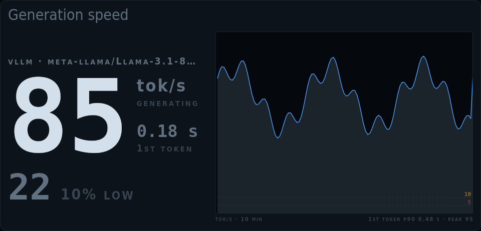
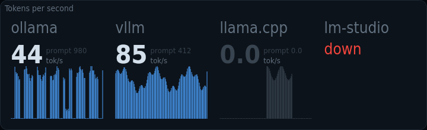
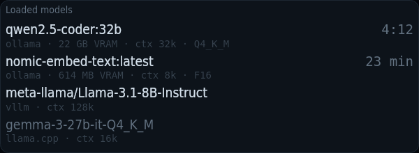
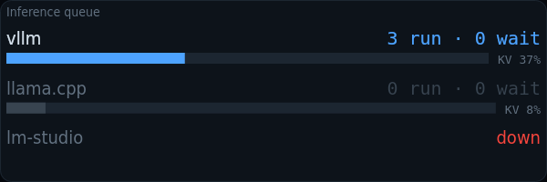
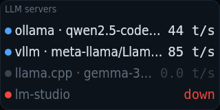

# kiosko-plugin-llm

Tokens per second (like FPS: the slow end and the time to first token too), loaded models and request queues of your local LLM servers.

A plugin for [Kiosko](https://github.com/kiosko-lcd/kiosko), the widget mosaic for small USB LCD panels.



## Install

In Kiosko, **Plugins → Install from npm** → `kiosko-plugin-llm`, then restart Kiosko. Or from a terminal:

```sh
npm install --prefix ~/.config/kiosko/plugins kiosko-plugin-llm
```

(macOS: `~/Library/Application Support/Kiosko/plugins`, Windows: `%APPDATA%\Kiosko\plugins`.)

## Requirements

- One or more inference servers reachable over HTTP: Ollama, llama.cpp `llama-server` (start it with `--metrics` for tokens/s, queue and KV cache; `/slots` for per-slot state), vLLM, TGI or any OpenAI-compatible server (LM Studio…).
- Ollama and LM Studio keep no speed figures a monitor can read: for tokens/s, time to first token and the low, turn on the [measuring proxy](#measuring-proxy-ollama-lm-studio) and point your apps at it. Without it, Ollama servers show their loaded models, size, VRAM, context and keep-alive countdown; LM Studio its loaded models.

## What it does on your machine

- **Internet**: contacts the ones you set in its options.
- **Listens**: only if you turn on the measuring proxy of a server: on the port you choose, on 127.0.0.1 unless you set another address.

## What each server gives

| | tokens/s | 10 % low | time to first token | how |
|---|---|---|---|---|
| vLLM | ✓ | ✓ | ✓ p50/p90 | `/metrics`: token counters; histograms `vllm:time_to_first_token_seconds` and `vllm:request_time_per_output_token_seconds` (or `vllm:time_per_output_token_seconds`, `vllm:inter_token_latency_seconds`) |
| llama.cpp `llama-server --metrics` | ✓ | ✓ | with the proxy | `/metrics`: `tokens_predicted_total` over `tokens_predicted_seconds_total` |
| TGI | ✓ | ✓ | with the proxy | `/metrics`: `tgi_request_mean_time_per_token_duration` |
| Ollama | with the proxy | with the proxy | with the proxy | the counts and timings in each answer |
| LM Studio | with the proxy | with the proxy | with the proxy | the `stats` in each answer |
| other OpenAI-compatible | with the proxy | with the proxy | with the proxy | `usage`, `timings`, or one token per chunk |

- **tokens/s**: what the server generates per second, all requests together, over the last poll.
- **10 % low**: the games' "1 % low" for answers: the decode speed the slowest tenth of the last 5 minutes' answers stay under (1 / p90 of the time per output token from the histograms; the p10 of each answer's speed through the proxy; llama.cpp, the p10 of the polls that decoded something). A model that spilled out of VRAM, a long context or a crowded batch show here first.
- **time to first token**: p50 and p90 of the last 5 minutes. Through the proxy, streamed answers are timed on the wall clock, as the client sees them (model loading included); others by the server's own figures.

## Measuring proxy (Ollama, LM Studio)

Ollama has no metrics endpoint: its routes ([`server/routes.go`](https://github.com/ollama/ollama/blob/v0.40.17/server/routes.go), v0.40.17) serve `/api/ps` (loaded models) but nothing with tokens/s; the speed of an answer is only in the answer itself (`eval_count`, `eval_duration`, `prompt_eval_*`, `load_duration`, [docs/api/usage.mdx](https://github.com/ollama/ollama/blob/v0.40.17/docs/api/usage.mdx); its OpenAI endpoints add llama.cpp's `timings`, [openai/openai.go](https://github.com/ollama/ollama/blob/v0.40.17/openai/openai.go)). Its logs are no way around it: `OLLAMA_DEBUG_LOG_REQUESTS` writes request bodies, not timings ([server/inference_request_log.go](https://github.com/ollama/ollama/blob/v0.40.17/server/inference_request_log.go)), and the request log lines give a duration but no token count. LM Studio is the same: `stats` (`tokens_per_second`, `time_to_first_token_seconds`…) come in each answer of its REST API ([chat](https://lmstudio.ai/docs/developer/rest/chat), [streaming events](https://lmstudio.ai/docs/developer/rest/streaming-events), [v0](https://lmstudio.ai/docs/developer/rest/endpoints)), with no server-side endpoint for them.

So the honest way is to read the answers as they go by. Set **Measuring proxy port** on the server in Kiosko → Settings → Data sources → LLM servers (say `11435` for an Ollama on `11434`, `1235` for an LM Studio on `1234`), then point your apps at that port instead of the server:

| app | setting |
|---|---|
| Ollama CLI, Python/JS libraries, Open WebUI… | `OLLAMA_HOST=127.0.0.1:11435` (Open WebUI: `OLLAMA_BASE_URL=http://127.0.0.1:11435`) |
| OpenAI clients (to Ollama or LM Studio) | base URL `http://127.0.0.1:11435/v1` (LM Studio: `http://127.0.0.1:1235/v1`) |
| LM Studio's own REST API | `http://127.0.0.1:1235/api/v1/…` |

Apps that keep talking to the server directly still work; only their answers go unmeasured.

What it does and doesn't:

- **Off by default.** Nothing listens until you set a port.
- **Local by default.** It listens on `127.0.0.1`; another address (**Measuring proxy listens on**, advanced) is your explicit choice, and then anyone who reaches this machine can use the server through it, as they could the server itself.
- **Unchanged traffic.** Requests and answers are piped through byte for byte, streaming included (NDJSON and server-sent events), with their headers (the client's own API key reaches the server; Kiosko adds none). Every route is passed; the inference ones are measured: `/api/generate`, `/api/chat`, `/v1/chat/completions`, `/v1/completions`, `/v1/responses`, `/v1/messages`, LM Studio's `/api/v0/…completions` and `/api/v1/chat`, llama.cpp's `/completion`.
- **Nothing stored but numbers.** Of each answer it keeps the model's name, token counts and times, for 30 minutes, in memory. Prompts, answers and headers are neither stored nor logged; a chunk is parsed to find the figures and dropped.
- **No delay of its own.** Chunks are forwarded as they arrive; headers go at once.
- **Client gone, generation stops.** If the app closes the connection mid-answer, the proxy closes its own to the server, as a direct connection would, and the server stops generating.
- **While Kiosko runs.** The proxy runs while the source does (a widget of this plugin on some screen). Stop Kiosko and apps pointed at the proxy get "connection refused" until it is back: point them at the server again if you stop using Kiosko.
- **Counts.** The server's own (`eval_count`, `timings`, LM Studio's `stats`, OpenAI `usage`); when an answer has none (an OpenAI stream without `stream_options.include_usage`), one token per chunk, close for Ollama and llama.cpp. The proxy says so (`proxy.estimated`).

## Widgets

### Generation speed — `llm/speed`

Tokens per second like a game shows FPS: the speed of one server or model, huge, the slowest tenth of the recent answers and the time to first token, and a curve of the last minutes. Dim while idle.


Uses: `llm/servers`.

| Option | Type | Default | |
|---|---|---|---|
| `server` | string | `""` | Empty: the one generating now, else the last that did. A name as in the source, or a pattern (gpu-*). |
| `model` | string | `""` | Empty: all the models of the server together. Per model with the measuring proxy; other servers, the model they hold. |
| `warnBelow` | number (tok/s) | `10` | Amber under. Tok/s; 0 = never. About reading speed: slower than this, you wait for the text. |
| `alertBelow` | number (tok/s) | `5` | Red under. Tok/s; 0 = never. Typically a model that spilled out of VRAM. |
| `historyMs` | duration (ms) | `600000` | Curve span. Up to 30 min, what the source keeps. |
| `showName` | boolean | `true` | Show the server and model |

While idle the big figure is the recent answers' speed, faint, instead of a zero.

### Tokens per second — `llm/throughput`

Generation tokens per second of each server in big figures, prompt processing in small, and a sparkline of the last minutes. Dim while idle.



Uses: `llm/servers`.

| Option | Type | Default | |
|---|---|---|---|
| `historyMs` | duration (ms) | `600000` | Sparkline span. Up to 30 min, what the source keeps. |
| `onlyWithRate` | boolean | `true` | Only servers that report tokens/s. Ollama and LM Studio report it only through the measuring proxy (see the source). |
| `servers` | list | `[]` | Servers. Empty: all. Names (as in the source) or patterns, comma-separated: * matches anything, a leading ! leaves out (vllm, gpu-*, !ollama). |

### Loaded models — `llm/models`

The models in memory across your servers: size and VRAM, context length and, for Ollama, how long until keep-alive unloads them.



Uses: `llm/servers`.

| Option | Type | Default | |
|---|---|---|---|
| `showServer` | boolean | `true` | Show the server name |
| `servers` | list | `[]` | Servers. Empty: all. Names (as in the source) or patterns, comma-separated: * matches anything, a leading ! leaves out (vllm, gpu-*, !ollama). |
| `rows` | number | `0` | Rows. 0 = as many as fit. A number shows that many, in rows of a readable size (fewer when the tile is too small for them); the rest are counted in "+N more". |
| `layout` | `auto` \| `one-line` \| `detailed` | `"auto"` | Row layout. Automatic: the widget picks by the tile's shape. |

### Inference queue — `llm/queue`

Requests running and waiting on each server, with its KV cache usage. Turns red, and keeps the tile, when too many wait or the cache is nearly full.



Uses: `llm/servers`.

| Option | Type | Default | |
|---|---|---|---|
| `waitingWarn` | number | `1` | Amber when this many requests wait |
| `waitingAlert` | number | `3` | Red when this many requests wait |
| `kvWarn` | number | `75` | Amber when the KV cache reaches |
| `kvAlert` | number | `90` | Red when the KV cache reaches |
| `onlyWithQueue` | boolean | `true` | Only servers that report a queue |
| `servers` | list | `[]` | Servers. Empty: all. Names (as in the source) or patterns, comma-separated: * matches anything, a leading ! leaves out (vllm, gpu-*, !ollama). |
| `rows` | number | `0` | Rows. 0 = as many as fit. A number shows that many, in rows of a readable size (fewer when the tile is too small for them); the rest are counted in "+N more". |

### LLM servers — `llm/status`

One line per server for small panels: up or down, the loaded model and its tokens per second.



Uses: `llm/servers`.

| Option | Type | Default | |
|---|---|---|---|
| `servers` | list | `[]` | Servers. Empty: all. Names (as in the source) or patterns, comma-separated: * matches anything, a leading ! leaves out (vllm, gpu-*, !ollama). |
| `rows` | number | `0` | Rows. 0 = as many as fit. A number shows that many, in rows of a readable size (fewer when the tile is too small for them); the rest are counted in "+N more". |

## Data sources

### LLM servers — `llm/servers`

Local inference servers (Ollama, llama.cpp, vLLM, TGI, OpenAI-compatible): reachability, loaded models, queue, tokens/s, KV cache and time to first token, where each exposes them. Read every 5 s while a widget uses it. Options are set once in Kiosko → Settings → Data sources.

| Option | Type | Default | |
|---|---|---|---|
| `endpoints` | list | … | Servers |

Each server:

| Option | Type | Default | |
|---|---|---|---|
| `name` | string | | Name |
| `kind` | `ollama` \| `llamacpp` \| `vllm` \| `openai` \| `tgi` | | Server |
| `url` | string | | Address |
| `token` | string (secret) | `""` | Bearer token, only if the server asks for an API key |
| `proxyPort` | number | `0` | Measuring proxy port, 0 = off. See [Measuring proxy](#measuring-proxy-ollama-lm-studio). |
| `proxyHost` | string | `"127.0.0.1"` | Where the measuring proxy listens (advanced). |

Templates: **Local AI** (generation speed, loaded models, queue).

## Development

```sh
npm install
npm test          # node:test
npm run check     # TypeScript
npm run build     # dist/index.js, what Kiosko loads
```

To try it in a running Kiosko without publishing: `kiosko plugins link .` and restart Kiosko.

Working on Kiosko and its plugins together: clone them side by side
(`kiosko/` and `kiosko-plugins/kiosko-plugin-llm/`) and run `npm install` in
`kiosko/`; its workspaces link every plugin found in `../kiosko-plugins`.

## License

MIT
