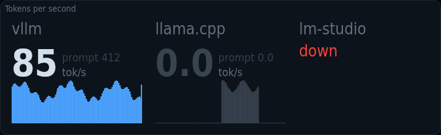
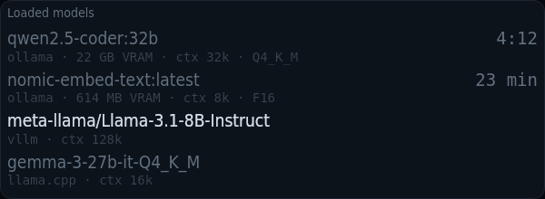
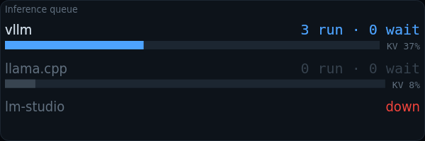
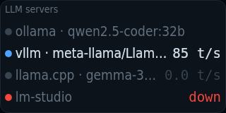

# kiosko-plugin-llm

Tokens per second, loaded models and request queues of your local LLM servers.

A plugin for [Kiosko](https://github.com/kiosko-lcd/kiosko), the widget mosaic for small USB LCD panels.



## Install

In Kiosko, **Plugins → Install from npm** → `kiosko-plugin-llm`, then restart Kiosko. Or from a terminal:

```sh
npm install --prefix ~/.config/kiosko/plugins kiosko-plugin-llm
```

(macOS: `~/Library/Application Support/Kiosko/plugins`, Windows: `%APPDATA%\Kiosko\plugins`.)

## Requirements

- One or more inference servers reachable over HTTP: Ollama, llama.cpp `llama-server` (start it with `--metrics` for tokens/s, queue and KV cache; `/slots` for per-slot state), vLLM, TGI or any OpenAI-compatible server (LM Studio…; only its model list and whether it answers).
- Ollama exposes no tokens/s, queue or KV-cache endpoint: for Ollama servers the widgets show the loaded models, their size, VRAM, context and keep-alive countdown, and leave tokens/s blank.

## Widgets

### Tokens per second — `llm/throughput`

Generation tokens per second of each server in big figures, prompt processing in small, and a sparkline of the last minutes. Dim while idle.


Uses: `llm/servers`.

| Option | Type | Default | |
|---|---|---|---|
| `minutes` | number | `10` | Sparkline span |
| `onlyWithRate` | boolean | `true` | Only servers that report tokens/s. Ollama does not expose tokens/s. |

### Loaded models — `llm/models`

The models in memory across your servers: size and VRAM, context length and, for Ollama, how long until keep-alive unloads them.



Uses: `llm/servers`.

| Option | Type | Default | |
|---|---|---|---|
| `showServer` | boolean | `true` | Show the server name |

### Inference queue — `llm/queue`

Requests running and waiting on each server, with its KV cache usage. Turns red when too many wait or the cache is nearly full.



Uses: `llm/servers`.

| Option | Type | Default | |
|---|---|---|---|
| `maxWaiting` | number | `2` | Alert when more requests wait than |
| `maxKv` | number | `90` | Alert when KV cache is above |
| `takeOver` | boolean | `true` | Take the cell over on alert. Marks the widget urgent while a server is over a threshold. |
| `onlyWithQueue` | boolean | `true` | Only servers that report a queue |

### LLM servers — `llm/status`

One line per server for small panels: up or down, the loaded model and its tokens per second.



Uses: `llm/servers`.

*No options.*

## Data sources

### LLM servers — `llm/servers`

Local inference servers (Ollama, llama.cpp, vLLM, TGI, OpenAI-compatible): reachability, loaded models, queue, tokens/s, KV cache and time to first token, where each exposes them. Read every 5 s while a widget uses it. Options are set once in Kiosko → Settings → Data sources.

| Option | Type | Default | |
|---|---|---|---|
| `endpoints` | list | … | Servers |
| `timeoutMs` | duration (ms) | `2000` | Timeout per request |

## Development

```sh
npm install
npm test          # node:test
npm run check     # TypeScript
npm run build     # dist/index.js, what Kiosko loads
```

To try it in a running Kiosko without publishing: `kiosko plugins link .` and restart Kiosko.

Working on Kiosko and its plugins together: clone them side by side
(`kiosko/` and `kiosko-plugins/kiosko-plugin-llm/`) and run `npm install` in
`kiosko/`; its workspaces link every plugin found in `../kiosko-plugins`.

## License

MIT
